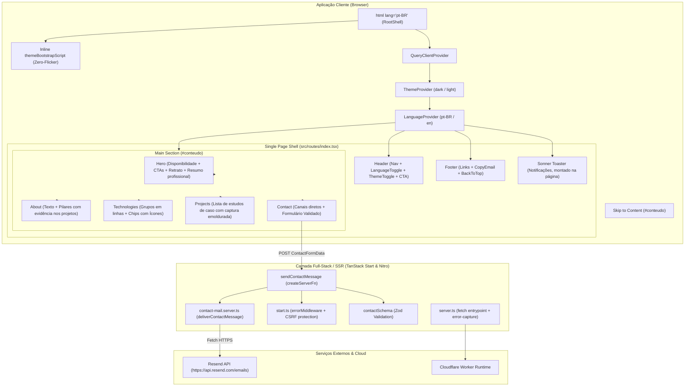
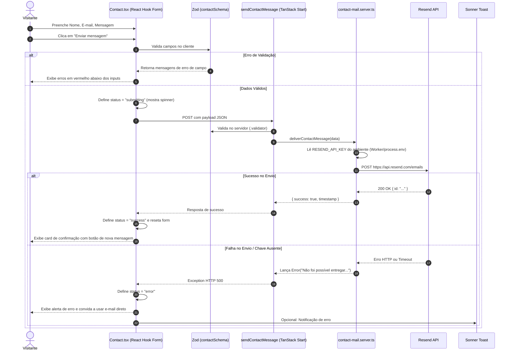
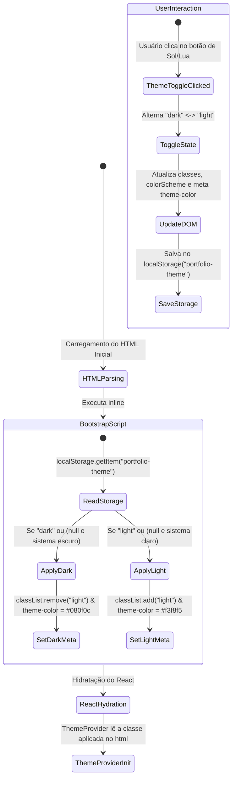

# 🗺️ Mapa Arquitetural do Portfólio (Codebase Map)

> **Aviso para Modelos / Agentes de IA:**
> Este documento mapeia **100% da arquitetura, dependências, componentes, fluxos de dados, estados e estilos** deste projeto.
> **Não é necessário ler os arquivos do repositório um a um.** Todas as decisões, tipos e estruturas essenciais estão sintetizados aqui.

---

## 1. Visão Geral da Stack & Topologia

- **Framework**: [TanStack Start](https://tanstack.com/start) (Full-stack SSR com React 19 e Vite 8)
- **Roteamento**: TanStack Router com _file-based routing_ (`src/routes/`)
- **Estilização**: Tailwind CSS v4 (`@tailwindcss/vite`), identidade verde-floresta/menta em OKLCH (herdada do visual original), com estrutura editorial em CSS variables
- **Animações**: CSS nativo + `IntersectionObserver` (`useRevealOnScroll`), sem bibliotecas de animação, com tratamento estrito de `prefers-reduced-motion`
- **Validação & Formulários**: React Hook Form + Zod (`@hookform/resolvers/zod`)
- **Comunicação Server-Side**: `createServerFn` do TanStack Start com envio de e-mails transacionais via Resend API
- **Build & Deploy**: Nitro (`cloudflare-module` preset) direcionado a Cloudflare Workers & Pages

---

## 2. Mapa Visual da Arquitetura (Graphify)



---

## 3. Catálogo Detalhado de Arquivos e Responsabilidades

### 3.1. Núcleo da Aplicação & Configurações de Rota

| Arquivo          | Caminho                 | Responsabilidade & Detalhes                                                                                                                                                                                                                                         | Exports Principais         | Dependências Chave                                                                            |
| ---------------- | ----------------------- | ------------------------------------------------------------------------------------------------------------------------------------------------------------------------------------------------------------------------------------------------------------------- | -------------------------- | --------------------------------------------------------------------------------------------- |
| **Entry Server** | `src/server.ts`         | Entrypoint do servidor SSR Nitro/Cloudflare. Captura erros críticos não tratados da camada h3 e renderiza página de fallback estática.                                                                                                                              | `export default { fetch }` | `@tanstack/react-start/server-entry`, `./lib/error-capture`, `./lib/error-page`               |
| **Start Config** | `src/start.ts`          | Configuração do TanStack Start com middlewares de CSRF para `serverFn` e middleware global de captura de erro 500.                                                                                                                                                  | `startInstance`            | `@tanstack/react-start`, `./lib/error-page`                                                   |
| **Router Setup** | `src/router.tsx`        | Instancia o `createRouter` integrando `QueryClient` do `@tanstack/react-query`, histórico e `scrollRestoration: true`.                                                                                                                                              | `getRouter()`              | `@tanstack/react-router`, `@tanstack/react-query`, `./routeTree.gen`                          |
| **Root Shell**   | `src/routes/__root.tsx` | Layout raiz HTML/Head. Meta tags globais, script inline anti-flicker (preferência salva ou `prefers-color-scheme`), fontes Archivo (títulos, eixos `wdth`/`wght`), Inter Tight (texto) e JetBrains Mono, `NotFoundComponent` e `ErrorComponent` (via `StatusPage`). | `Route`                    | `@tanstack/react-router`, `@tanstack/react-query`, `@/data/portfolio`, `@/theme/theme-config` |
| **Home Page**    | `src/routes/index.tsx`  | Rota principal `/`. Providers (`ThemeProvider`, `LanguageProvider`), SEO (Open Graph `profile`, Twitter, canonical, JSON-LD `Person` com `alumniOf`/`knowsAbout`), `useRevealOnScroll()`, skip link, seções e `<Toaster />`.                                        | `Route`                    | Componentes de portfolio, dados de `portfolio.ts`, providers                                  |
| **Route Tree**   | `src/routeTree.gen.ts`  | Árvore de rotas gerada automaticamente pelo plugin TanStack Router. **Não editar manualmente**.                                                                                                                                                                     | `routeTree`                | `@tanstack/react-router`                                                                      |

---

### 3.2. Estado Global e Internacionalização

| Arquivo               | Caminho                         | Responsabilidade & Detalhes                                                                                                                                                                                            | Exports Principais                                                             |
| --------------------- | ------------------------------- | ---------------------------------------------------------------------------------------------------------------------------------------------------------------------------------------------------------------------- | ------------------------------------------------------------------------------ |
| **Theme Config**      | `src/theme/theme-config.ts`     | Tipo `Theme`, chave `portfolio-theme` e cores de `theme-color` (`#080f0c` dark, `#f3f8f5` light), compartilhados com o script anti-flicker.                                                                            | `Theme`, `themeStorageKey`, `themeColors`                                      |
| **Theme Provider**    | `src/theme/ThemeProvider.tsx`   | Controla tema `dark` / `light` (sincroniza com a classe aplicada pelo script e segue o sistema se não houver escolha salva). Desativa transições durante a troca (`.theme-switching`).                                 | `ThemeProvider`, `useTheme()`, tipo `Theme`                                    |
| **Language Provider** | `src/i18n/LanguageProvider.tsx` | Dicionários `pt-BR` (padrão) e `en`. Textos de seções indexados por id (`projects.entries[projectId]`, `technologies.groups[groupId]`, `about.pillars[pillarId]`), garantindo paridade de chaves pelo tipo `Messages`. | `LanguageProvider`, `useLanguage()`, `languages`, tipos `Language`, `Messages` |

---

### 3.3. Componentes da Interface (`src/components/portfolio/`)

| Componente         | Arquivo                 | Responsabilidade Técnica & UX                                                                                                                                                                                                                                                                                                                                                                                        |
| ------------------ | ----------------------- | -------------------------------------------------------------------------------------------------------------------------------------------------------------------------------------------------------------------------------------------------------------------------------------------------------------------------------------------------------------------------------------------------------------------- |
| **Header**         | `Header.tsx`            | Barra `sticky` com blur e Scroll-Spy (`IntersectionObserver`, `aria-current="location"`). Desktop: links Sobre/Stack/Projetos + `LanguageToggle` (PT/EN, `aria-pressed`) + `ThemeToggle` + CTA "Fale comigo". Mobile: painel com links numerados, foco no primeiro link ao abrir, fecha com Escape/clique fora/resize.                                                                                               |
| **SectionHeading** | `SectionHeading.tsx`    | Cabeçalho padrão das seções: `h2` com filete vertical de acento e `id` para `aria-labelledby` e introdução opcional.                                                                                                                                                                                                                                                                                                 |
| **Hero**           | `Hero.tsx`              | Selo de disponibilidade, `h1` com o nome, cargo + foco, descrição, CTAs (Ver projetos / Baixar currículo), cargo com efeito de digitação (`.typing-role`), retrato grande com moldura vazada (`.frame-square`; no mobile fica acima do texto, limitado a 58svh) e faixa "Resumo profissional" (`dl`) com projetos publicados (derivado dos dados), foco, formação e base. Entrada via CSS (`.rise`, `.portrait-in`). |
| **About**          | `About.tsx`             | Título fixo (`sticky`) à esquerda; à direita, texto e 3 pilares (`pillars`) com links "Aplicado em" para os projetos que comprovam cada competência (`#projeto-{id}`).                                                                                                                                                                                                                                               |
| **Technologies**   | `Technologies.tsx`      | Grupos (Front-end, Back-end, Dados e entrega) em linhas: título + resumo à esquerda, chips com `TechIcon` à direita.                                                                                                                                                                                                                                                                                                 |
| **TechIcon**       | `TechIcon.tsx`          | Ícones de tecnologias (`react-icons/si` + `lucide-react`) usados em `Technologies.tsx` e `Projects.tsx`.                                                                                                                                                                                                                                                                                                             |
| **Projects**       | `Projects.tsx`          | Lista ordenada de estudos de caso (`ProjectCase`): categoria, nome, destaque técnico, descrição, stack e links demo/código; captura em moldura com o host real da demo. Mobile: captura acima do texto. Link "Ver todos no GitHub".                                                                                                                                                                                  |
| **Contact**        | `Contact.tsx`           | Canais diretos (copiar e-mail, LinkedIn, GitHub, currículo) + formulário Zod bilíngue com React Hook Form, `Ctrl/Cmd + Enter`, `aria-busy`, alerta de erro e foco movido para o título de sucesso.                                                                                                                                                                                                                   |
| **Footer**         | `Footer.tsx`            | Nome, tagline, links com rótulo visível (GitHub, LinkedIn, copiar e-mail, currículo), créditos de stack e "Voltar ao topo".                                                                                                                                                                                                                                                                                          |
| **Internal Nav**   | `internalNavigation.ts` | `scrollToSection(event, id)`: rolagem suave (instantânea com movimento reduzido) e foco programático no destino (`tabindex="-1"`) para leitores de tela e teclado.                                                                                                                                                                                                                                                   |

---

### 3.4. Componentes UI Reutilizáveis (`src/components/ui/`)

| Componente        | Arquivo                              | Descrição                                                                                                                            |
| ----------------- | ------------------------------------ | ------------------------------------------------------------------------------------------------------------------------------------ |
| **Button styles** | `src/components/ui/button-styles.ts` | `buttonClasses(variant, size, className)` (`primary` / `secondary`, `sm` / `md`) e `buttonIconNudge` para ícones com microinteração. |
| **Sonner**        | `src/components/ui/sonner.tsx`       | Provedor de toasts leves integrado com as classes do Tailwind e variáveis de tema.                                                   |

---

### 3.5. Funções de Servidor, Utilitários & Hooks

| Módulo                | Arquivo                          | Responsabilidade                                                                                                                                                                                               |
| --------------------- | -------------------------------- | -------------------------------------------------------------------------------------------------------------------------------------------------------------------------------------------------------------- |
| **Contact Client/Fn** | `src/lib/contact.ts`             | Define `createContactSchema(messages)` (validação Zod bilíngue), `contactSchema` (Zod server-side: `name`, `email`, `message`) e a função servidora `sendContactMessage = createServerFn({ method: "POST" })`. |
| **Contact Mailer**    | `src/lib/contact-mail.server.ts` | Executado exclusivamente no servidor. Lê variáveis de ambiente (`RESEND_API_KEY`, `CONTACT_TO_EMAIL`, `CONTACT_FROM_EMAIL`), escapa HTML e envia requisição HTTPS para a API do Resend.                        |
| **useRevealOnScroll** | `src/hooks/useRevealOnScroll.ts` | Marca como `pending` apenas os elementos `[data-reveal]` abaixo da dobra e os revela com `IntersectionObserver`. Sem JS ou com movimento reduzido, tudo fica visível.                                          |
| **Error Capture**     | `src/lib/error-capture.ts`       | Intercepta erros não capturados e chamadas `console.error` para contornar limitações do h3, mantendo stack traces e causas de erro.                                                                            |
| **Error Page**        | `src/lib/error-page.ts`          | Template HTML puro para respostas 500 caso ocorra falha catastrófica de SSR sem quebrar a resposta HTTP.                                                                                                       |
| **Utils**             | `src/lib/utils.ts`               | `cn(...inputs)` (`clsx` + `tailwind-merge`) e `prefersReducedMotion()`.                                                                                                                                        |
| **useCopyEmail**      | `src/hooks/useCopyEmail.ts`      | Copia o e-mail para `navigator.clipboard`, altera ícone temporariamente por 2s e dispara toast no Sonner (com ajuste mobile/desktop).                                                                          |
| **useMobile**         | `src/hooks/use-mobile.tsx`       | Hook que escuta a media query `(max-width: 767px)` para alternar layouts e comportamentos dinâmicos.                                                                                                           |

---

### 3.6. Dados Estáticos do Portfólio (`src/data/portfolio.ts`)

Centraliza todas as informações do profissional:

- `profile`: Nome, role ("Desenvolvedor Front-end"), iniciais, avatar WebP, instituição (Senac RS) e localização.
- `links`: GitHub (`zGeanx`), LinkedIn, E-mail (`geanlucadias12@gmail.com`), Currículo (`/gean-luca-cv.pdf`) e nome do arquivo baixado.
- `sectionIds`: ids das seções usados pelo Scroll-Spy (`inicio`, `sobre`, `tecnologias`, `projetos`, `contato`).
- `techGroups`: `frontend`, `backend`, `delivery` (textos em `messages.technologies.groups`).
- `pillars`: competências (`interfaces`, `apis`, `delivery`) com os ids dos projetos que as comprovam.
- `publishedProjectCount`: total de projetos com demo publicada (exibido no Hero).
- `projects` (textos em `messages.projects.entries[id]`):
  1. **Pulso TV** (React, Vinext, Vite, TS, Tailwind, Cloudflare Workers)
  2. **Sistema de Folgas** (React, Vite, Django, DRF, JWT, PostgreSQL, Supabase)
  3. **API Pulso** (Hono, Cloudflare Workers, D1, React, TS, JWT, Zod)
  4. **Books Library** (Next.js, TS, Flask, SQLite, Docker, shadcn/ui)

---

## 4. Fluxo do Formulário de Contato (Sequence Diagram)



---

## 5. Ciclo de Vida do Tema & Anti-Flicker (State Flow)



---

## 6. Sistema de Animação & Motion Pipeline

1. **Entrada do Hero (CSS puro)**: `.rise` (fade + translate, atraso por `--rise-delay`) e `.portrait-in` (revelação do retrato com `clip-path`).
2. **Revelação ao rolar (`useRevealOnScroll`)**: elementos com `data-reveal=""` abaixo da dobra recebem `pending` e passam a `visible` ao entrar na viewport; atraso escalonado via `--reveal-delay`.
3. **Microinterações**: deslocamento de ícones em botões (`buttonIconNudge`), sublinhado animado (`link-underline`), zoom sutil das capturas (`.project-shot`) apenas em dispositivos com hover.
4. **Acessibilidade estrita**: com `prefers-reduced-motion: reduce`, animações e transições são neutralizadas em CSS e o hook não esconde nada; a troca de tema desativa transições (`.theme-switching`); impressão força tudo visível.

---

## 7. Tokens de Design & Tailwind CSS v4

O projeto utiliza **Tailwind CSS v4** com tokens declarados via `@theme inline` em `src/styles.css`:

```css
/* Paleta Dark (padrão sem preferência do sistema) */
--background: oklch(0.16 0.014 165); /* #080f0c verde-floresta escuro */
--foreground: oklch(0.95 0.008 165); /* 16.8:1 */
--muted-foreground: oklch(0.72 0.022 165); /* 7.9:1 */
--primary: oklch(0.78 0.12 165); /* menta, 10.2:1 */
--border: oklch(0.3 0.02 165);
--border-strong: oklch(0.52 0.04 165); /* bordas de campos ≥ 3:1 */

/* Paleta Light (.light) */
--background: oklch(0.975 0.007 165); /* #f3f8f5 */
--foreground: oklch(0.19 0.025 165); /* 17.1:1 */
--muted-foreground: oklch(0.4 0.025 165); /* 8.5:1 */
--primary: oklch(0.46 0.12 165); /* 6.1:1 (texto claro sobre ele: 6.3:1) */
```

- **Utilitários próprios**: `shell` (container), `section-y` (ritmo vertical), `display` (títulos em Archivo semi-expandida), `eyebrow` (rótulos mono), `link-underline`.
- **Fontes**:
  - Sans: `Inter Tight` para texto corrido; `Archivo` variável (`wdth` 100–125) apenas em títulos (`font-display`)
  - Mono: `JetBrains Mono` 400/500 para cargo, rótulos, hosts e stacks

---

## 8. Comandos e Scripts de Automação

- `npm run dev`: Inicia o servidor Vite local na porta configurada (`http://localhost:8080`).
- `npm run build`: Executa `vite build` gerando a saída SSR Nitro em `.output/` e roda em seguida `node scripts/attach-contact-secret.mjs`.
- `scripts/attach-contact-secret.mjs`: Script pós-build que lê `RESEND_API_KEY` do ambiente de CI/build e injeta no arquivo `.output/server/wrangler.json` para que o worker Cloudflare receba o segredo.

---

## 9. Regras de Ouro para Qualquer Modelo que for Alterar o Código

1. **Não introduzir convenções Next.js ou Remix**: TanStack Start usa apenas `src/routes/` e o layout raiz é `src/routes/__root.tsx`. Não criar `app/` ou `pages/`.
2. **Nunca editar `src/routeTree.gen.ts` manualmente**: Ele é gerado e sincronizado pelo compilador do TanStack Router.
3. **Respeitar `prefers-reduced-motion`**: Qualquer nova animação interativa DEVE respeitar a preferência de movimento reduzido do sistema operacional.
4. **Respeitar o Bilinguismo**: Novos textos visíveis devem ser adicionados tanto em `ptBR` quanto no bloco correspondente `en` em `src/i18n/LanguageProvider.tsx`.
5. **Verificação de Build**: Qualquer alteração de código deve ser validada com `npm run build`.
