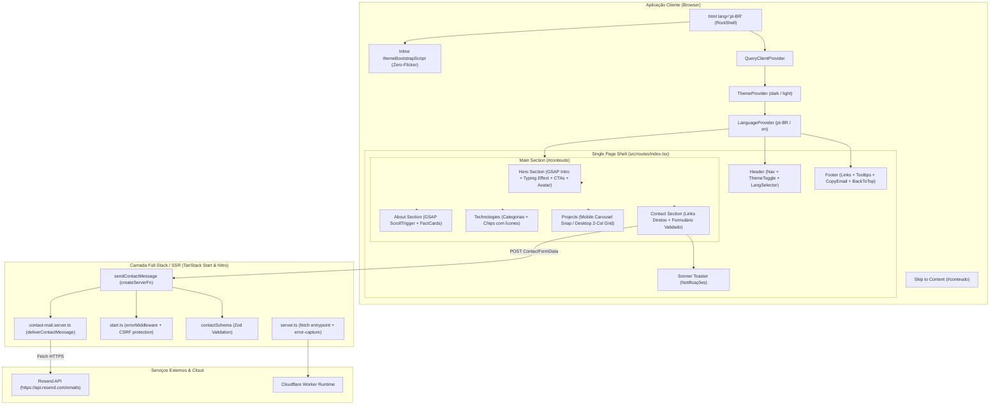
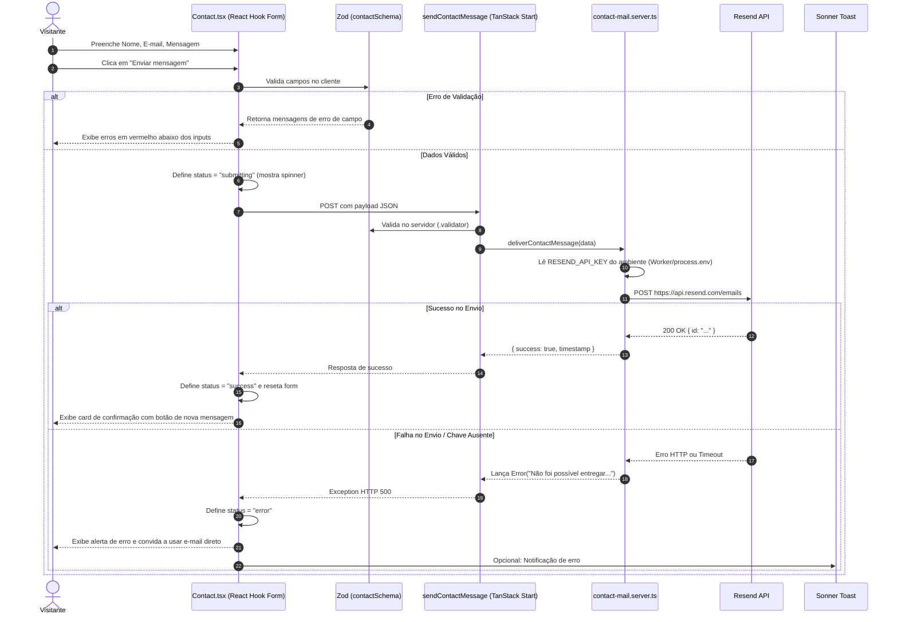
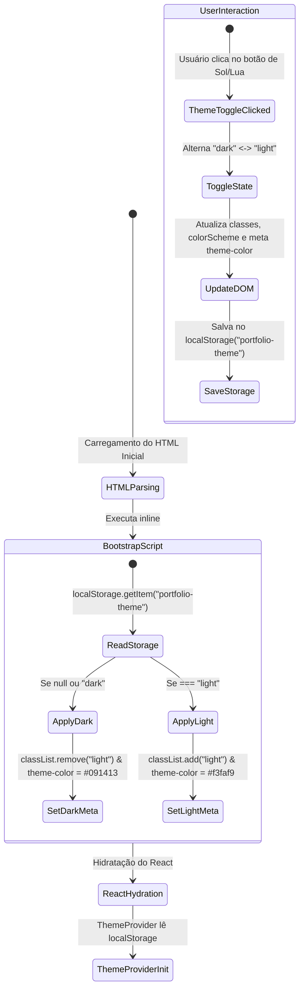

# 🗺️ Mapa Arquitetural do Portfólio (Codebase Map)

> **Aviso para Modelos / Agentes de IA:**
> Este documento mapeia **100% da arquitetura, dependências, componentes, fluxos de dados, estados e estilos** deste projeto.
> **Não é necessário ler os arquivos do repositório um a um.** Todas as decisões, tipos e estruturas essenciais estão sintetizados aqui.

---

## 1. Visão Geral da Stack & Topologia

- **Framework**: [TanStack Start](https://tanstack.com/start) (Full-stack SSR com React 19 e Vite 8)
- **Roteamento**: TanStack Router com _file-based routing_ (`src/routes/`)
- **Estilização**: Tailwind CSS v4 (`@tailwindcss/vite`), paleta temática OKLCH Mint/Teal em CSS variables
- **Animações**: GSAP 3.15 (`gsap`, `ScrollTrigger`, `@gsap/react`) com tratamento estrito de acessibilidade (`prefers-reduced-motion`)
- **Validação & Formulários**: React Hook Form + Zod (`@hookform/resolvers/zod`)
- **Comunicação Server-Side**: `createServerFn` do TanStack Start com envio de e-mails transacionais via Resend API
- **Build & Deploy**: Nitro (`cloudflare-module` preset) direcionado a Cloudflare Workers & Pages

---

## 2. Mapa Visual da Arquitetura (Graphify)



---

## 3. Catálogo Detalhado de Arquivos e Responsabilidades

### 3.1. Núcleo da Aplicação & Configurações de Rota

| Arquivo          | Caminho                 | Responsabilidade & Detalhes                                                                                                                                            | Exports Principais         | Dependências Chave                                                              |
| ---------------- | ----------------------- | ---------------------------------------------------------------------------------------------------------------------------------------------------------------------- | -------------------------- | ------------------------------------------------------------------------------- |
| **Entry Server** | `src/server.ts`         | Entrypoint do servidor SSR Nitro/Cloudflare. Captura erros críticos não tratados da camada h3 e renderiza página de fallback estática.                                 | `export default { fetch }` | `@tanstack/react-start/server-entry`, `./lib/error-capture`, `./lib/error-page` |
| **Start Config** | `src/start.ts`          | Configuração do TanStack Start com middlewares de CSRF para `serverFn` e middleware global de captura de erro 500.                                                     | `startInstance`            | `@tanstack/react-start`, `./lib/error-page`                                     |
| **Router Setup** | `src/router.tsx`        | Instancia o `createRouter` integrando `QueryClient` do `@tanstack/react-query`, histórico e `scrollRestoration: true`.                                                 | `getRouter()`              | `@tanstack/react-router`, `@tanstack/react-query`, `./routeTree.gen`            |
| **Root Shell**   | `src/routes/__root.tsx` | Layout raiz HTML/Head. Configura meta tags OpenGraph, script inline do tema anti-flicker, fontes Inter Tight e JetBrains Mono, `NotFoundComponent` e `ErrorComponent`. | `Route`                    | `@tanstack/react-router`, `@tanstack/react-query`, `@/data/portfolio`           |
| **Home Page**    | `src/routes/index.tsx`  | Rota principal `/`. Envolve a aplicação nos providers (`ThemeProvider`, `LanguageProvider`), monta SEO com JSON-LD de `Person` e renderiza todas as seções.            | `Route`                    | Componentes de portfolio, dados de `portfolio.ts`, providers                    |
| **Route Tree**   | `src/routeTree.gen.ts`  | Árvore de rotas gerada automaticamente pelo plugin TanStack Router. **Não editar manualmente**.                                                                        | `routeTree`                | `@tanstack/react-router`                                                        |

---

### 3.2. Estado Global e Internacionalização

| Arquivo               | Caminho                         | Responsabilidade & Detalhes                                                                                                                                                                               | Exports Principais                                                             |
| --------------------- | ------------------------------- | --------------------------------------------------------------------------------------------------------------------------------------------------------------------------------------------------------- | ------------------------------------------------------------------------------ |
| **Theme Provider**    | `src/theme/ThemeProvider.tsx`   | Controla tema `dark` / `light`. Atualiza classe `.light` no `<html>`, `colorScheme` e `<meta name="theme-color">` (`#091413` no dark, `#f3faf9` no light). Persiste em `localStorage("portfolio-theme")`. | `ThemeProvider`, `useTheme()`, tipo `Theme`                                    |
| **Language Provider** | `src/i18n/LanguageProvider.tsx` | Gerencia dicionários e tradução dinâmica (`pt-BR` padrão e `en`). Contém textos completos de meta tags, cabeçalho, hero, sobre, stacks, projetos e rodapé.                                                | `LanguageProvider`, `useLanguage()`, `languages`, tipos `Language`, `Messages` |

---

### 3.3. Componentes da Interface (`src/components/portfolio/`)

| Componente       | Arquivo                 | Responsabilidade Técnica & UX                                                                                                                                                                                                                                                                                                                                               |
| ---------------- | ----------------------- | --------------------------------------------------------------------------------------------------------------------------------------------------------------------------------------------------------------------------------------------------------------------------------------------------------------------------------------------------------------------------- |
| **Header**       | `Header.tsx`            | Barra de navegação fixa (`sticky top-0`) com backdrop-blur e Scroll-Spy (`IntersectionObserver`). Inclui links âncora com estado ativo (`aria-current="location"`), seletor de idiomas dropdown acessível, toggle de tema com `.icon-swap` e menu mobile responsivo.                                                                                                        |
| **Hero**         | `Hero.tsx`              | Seção inicial com título com gradiente, animação de máquina de escrever CSS (`typing-role`), botões de ação (Ver projetos, Contato, GitHub, Download CV) e avatar otimizado em moldura com brilho OKLCH (`max-w-[190px]` no mobile). Animação de entrada orquestrada via GSAP Timeline (`useGSAP`).                                                                         |
| **About**        | `About.tsx`             | Seção "Sobre mim" (01 // sobre) apresentando formação (ADS Senac RS), foco em React/TypeScript e 3 cards de fatos (`FactCard`: Localização, Foco Técnico, Formação). Entrada com GSAP `ScrollTrigger`.                                                                                                                                                                      |
| **Technologies** | `Technologies.tsx`      | Seção "Tecnologias" (02 // stack). Agrupamento em 3 pilares: **Front-end**, **Back-end**, **Dados e entrega** com descrição resumo por pilar, destaque para a stack principal (`coreStack`) e ícones via `TechIcon.tsx`. Animação staggered com GSAP.                                                                                                                       |
| **TechIcon**     | `TechIcon.tsx`          | Componente compartilhado de ícones de tecnologias (`react-icons/si` + `lucide-react`) utilizado tanto em `Technologies.tsx` quanto nos badges dos cards de `Projects.tsx`.                                                                                                                                                                                                  |
| **Projects**     | `Projects.tsx`          | Seção "Projetos" (03 // projetos). **Mobile**: carrossel com snap scroll (`scroll-snap-type: x mandatory`), botões anterior/próximo com detecção de bordas via `ResizeObserver` e bolinhas indicadoras interativas com alvo de toque de 44px. **Desktop**: card em destaque 2 colunas + grid de 3 colunas com badges de tech icônicos, highlight técnico e links demo/repo. |
| **Contact**      | `Contact.tsx`           | Seção "Contato" (04 // contato). Coluna esquerda com canais diretos (E-mail com cópia para clipboard em 1 clique, links de LinkedIn e GitHub). Coluna direita com formulário validado por Zod bilíngue (`createContactSchema`) + React Hook Form, atalho `Ctrl/Cmd + Enter`, estado de loading e mensagens de sucesso/erro. Inclui `<Toaster />` do Sonner.                 |
| **Footer**       | `Footer.tsx`            | Rodapé com copyright, links sociais protegidos por `<Tooltip>` (`skipDelayDuration={300}`), botão de copiar e-mail e botão "Voltar ao topo" com rolagem suave.                                                                                                                                                                                                              |
| **Internal Nav** | `internalNavigation.ts` | Helper utilitário `scrollToSection(event, id)` com `preventDefault()` e `scrollIntoView({ behavior: "smooth", block: "start" })`.                                                                                                                                                                                                                                           |

---

### 3.4. Componentes UI Reutilizáveis (`src/components/ui/`)

| Componente  | Arquivo                         | Descrição                                                                                                           |
| ----------- | ------------------------------- | ------------------------------------------------------------------------------------------------------------------- |
| **Tooltip** | `src/components/ui/tooltip.tsx` | Wrapper Radix UI (`@radix-ui/react-tooltip`) estilizado com classes Tailwind, bordas suaves e transições fade/zoom. |
| **Sonner**  | `src/components/ui/sonner.tsx`  | Provedor de toasts leves integrado com as classes do Tailwind e variáveis de tema.                                  |

---

### 3.5. Funções de Servidor, Utilitários & Hooks

| Módulo                | Arquivo                          | Responsabilidade                                                                                                                                                                                               |
| --------------------- | -------------------------------- | -------------------------------------------------------------------------------------------------------------------------------------------------------------------------------------------------------------- |
| **Contact Client/Fn** | `src/lib/contact.ts`             | Define `createContactSchema(messages)` (validação Zod bilíngue), `contactSchema` (Zod server-side: `name`, `email`, `message`) e a função servidora `sendContactMessage = createServerFn({ method: "POST" })`. |
| **Contact Mailer**    | `src/lib/contact-mail.server.ts` | Executado exclusivamente no servidor. Lê variáveis de ambiente (`RESEND_API_KEY`, `CONTACT_TO_EMAIL`, `CONTACT_FROM_EMAIL`), escapa HTML e envia requisição HTTPS para a API do Resend.                        |
| **GSAP Setup**        | `src/lib/gsap.ts`                | Inicializa e registra `ScrollTrigger` e `useGSAP` apenas no ambiente do navegador (`typeof window !== "undefined"`).                                                                                           |
| **Error Capture**     | `src/lib/error-capture.ts`       | Intercepta erros não capturados e chamadas `console.error` para contornar limitações do h3, mantendo stack traces e causas de erro.                                                                            |
| **Error Page**        | `src/lib/error-page.ts`          | Template HTML puro para respostas 500 caso ocorra falha catastrófica de SSR sem quebrar a resposta HTTP.                                                                                                       |
| **Utils**             | `src/lib/utils.ts`               | Utilitário `cn(...inputs)` combinando `clsx` e `tailwind-merge`.                                                                                                                                               |
| **useCopyEmail**      | `src/hooks/useCopyEmail.ts`      | Copia o e-mail para `navigator.clipboard`, altera ícone temporariamente por 2s e dispara toast no Sonner (com ajuste mobile/desktop).                                                                          |
| **useMobile**         | `src/hooks/use-mobile.tsx`       | Hook que escuta a media query `(max-width: 767px)` para alternar layouts e comportamentos dinâmicos.                                                                                                           |

---

### 3.6. Dados Estáticos do Portfólio (`src/data/portfolio.ts`)

Centraliza todas as informações do profissional:

- `profile`: Nome, role ("Desenvolvedor Front-end"), bio, avatar WebP.
- `facts`: Localização (Pelotas, RS), Atuação, Formação (ADS no Senac RS).
- `links`: GitHub (`zGeanx`), LinkedIn, E-mail (`geanlucadias12@gmail.com`), Currículo (`/gean-luca-cv.pdf`).
- `techGroups`: Front-end, Back-end, Dados e entrega.
- `projects`:
  1. **Pulso TV** (React, Vinext, Vite, TS, Tailwind, Cloudflare Workers)
  2. **Sistema de Folgas** (React, Vite, Django, DRF, JWT, PostgreSQL, Supabase)
  3. **API Pulso** (Hono, Cloudflare Workers, D1, React, TS, JWT, Zod)
  4. **Books Library** (Next.js, TS, Flask, SQLite, Docker, shadcn/ui)

---

## 4. Fluxo do Formulário de Contato (Sequence Diagram)



---

## 5. Ciclo de Vida do Tema & Anti-Flicker (State Flow)



---

## 6. Sistema de Animação & Motion Pipeline

1. **GSAP + ScrollTrigger (`src/lib/gsap.ts`)**:
   - `Hero`: Timeline encadeada com `.from()` escalonando `.hero-title`, `.hero-role`, `.hero-desc`, `.hero-cta` e `.hero-avatar`.
   - `About`: `ScrollTrigger` ativado em `top 85%` para o cabeçalho e `top 88%` escalonando `.fact-card`.
   - `Technologies`: `ScrollTrigger` disparando animação com stagger em `.tech-group`.
   - `Projects`: Animação suave nos cards do desktop (`.desktop-project-card`).
   - `Contact`: Entrada suave do container `.contact-panel`.
2. **Acessibilidade estrita**:
   - Todas as animações GSAP verificam `window.matchMedia("(prefers-reduced-motion: reduce)").matches` e retornam imediatamente caso o usuário prefira movimento reduzido.
3. **CSS Específico (`src/styles.css`)**:
   - Efeito de digitação com cursor piscante: `.typing-role` com `@keyframes typing` e `@keyframes blink`.
   - Backdrops com gradientes radiais em OKLCH: `.hero-backdrop`.

---

## 7. Tokens de Design & Tailwind CSS v4

O projeto utiliza **Tailwind CSS v4** com tokens declarados via `@theme inline` em `src/styles.css`:

```css
/* Paleta Dark (Padrão) */
--background: oklch(0.13 0.015 165); /* #091413 tom verde petróleo profundo */
--foreground: oklch(0.96 0.008 165); /* Quase branco esmeralda */
--surface: oklch(0.175 0.018 165); /* Fundo de cards */
--surface-2: oklch(0.225 0.022 165); /* Hover / elementos ativos */
--primary: oklch(0.78 0.13 165); /* Verde menta vibrante (acento principal) */
--border: oklch(0.3 0.025 165); /* Linhas e separadores sutis */
--border-strong: oklch(0.44 0.035 165);

/* Paleta Light (.light) */
--background: oklch(0.98 0.008 165); /* #f3faf9 tom gelo com leve matiz menta */
--foreground: oklch(0.18 0.03 165); /* Texto escuro com alto contraste */
--surface: oklch(0.998 0.004 165);
--primary: oklch(0.46 0.13 165); /* Verde menta mais escuro para contraste AA */
```

- **Fontes**:
  - Sans: `Inter Tight`, sans-serif (para títulos e texto corrido)
  - Mono: `JetBrains Mono`, monospace (para tags, labels, números de seção `01 //` e código)

---

## 8. Comandos e Scripts de Automação

- `npm run dev`: Inicia o servidor Vite local na porta configurada (`http://localhost:8080`).
- `npm run build`: Executa `vite build` gerando a saída SSR Nitro em `.output/` e roda em seguida `node scripts/attach-contact-secret.mjs`.
- `scripts/attach-contact-secret.mjs`: Script pós-build que lê `RESEND_API_KEY` do ambiente de CI/build e injeta no arquivo `.output/server/wrangler.json` para que o worker Cloudflare receba o segredo.

---

## 9. Regras de Ouro para Qualquer Modelo que for Alterar o Código

1. **Não introduzir convenções Next.js ou Remix**: TanStack Start usa apenas `src/routes/` e o layout raiz é `src/routes/__root.tsx`. Não criar `app/` ou `pages/`.
2. **Nunca editar `src/routeTree.gen.ts` manualmente**: Ele é gerado e sincronizado pelo compilador do TanStack Router.
3. **Respeitar `prefers-reduced-motion`**: Qualquer nova animação interativa DEVE respeitar a preferência de movimento reduzido do sistema operacional.
4. **Respeitar o Bilinguismo**: Novos textos visíveis devem ser adicionados tanto em `ptBR` quanto no bloco correspondente `en` em `src/i18n/LanguageProvider.tsx`.
5. **Verificação de Build**: Qualquer alteração de código deve ser validada com `npm run build`.
